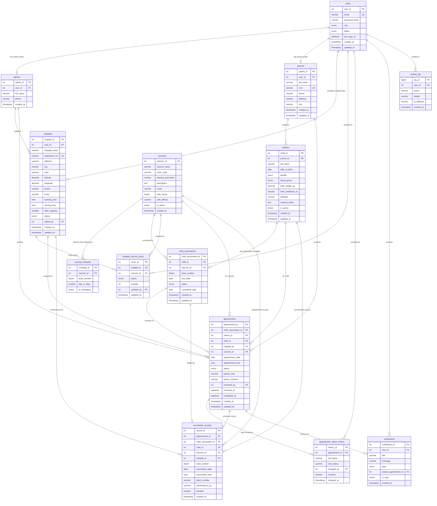

# Vaccination Management System (`vaccination_db`) — Entity-Relationship Diagram

> **Source of Truth:** [sql/official_schema.sql](../sql/official_schema.sql)  
> **Scope:** All **14 base tables**, primary keys (`PK`), foreign keys (`FK`), unique keys (`UK`), and `ON DELETE` referential integrity rules.

---

## 1. Visual ER Diagram (Mermaid)

---

## 2. Foreign Key & Referential Integrity Matrix (All 26 Constraints)

| Table | Constraint | Column | References | `ON DELETE` | Purpose |
|---|---|---|---|---|---|
| `admins` | `fk_admin_user` | `user_id` | `users(user_id)` | `CASCADE` | Links admin profile to login account |
| `parents` | `fk_parent_user` | `user_id` | `users(user_id)` | `CASCADE` | Links parent profile to login account |
| `hospitals` | `fk_hosp_user` | `user_id` | `users(user_id)` | `SET NULL` | Links hospital staff login (preserved if user deleted) |
| `hospitals` | `fk_hosp_admin` | `added_by` | `admins(admin_id)` | `SET NULL` | Tracks which admin added the hospital |
| `children` | `fk_child_parent` | `parent_id` | `parents(parent_id)` | `CASCADE` | Assigns child to parent (app uses soft-delete `is_active=0`) |
| `vaccine_schedule` | `fk_sched_vaccine` | `vaccine_id` | `vaccines(vaccine_id)` | `CASCADE` | Standard age offsets per dose |
| `child_vaccinations` | `fk_cv_child` | `child_id` | `children(child_id)` | `CASCADE` | Child's personalized dose rows |
| `child_vaccinations` | `fk_cv_vaccine` | `vaccine_id` | `vaccines(vaccine_id)` | `CASCADE` | Vaccine linked to each scheduled dose |
| `hospital_vaccine_stock` | `fk_stock_hospital` | `hospital_id` | `hospitals(hospital_id)` | `CASCADE` | Facility owning the stock |
| `hospital_vaccine_stock` | `fk_stock_vaccine` | `vaccine_id` | `vaccines(vaccine_id)` | `CASCADE` | Stocked vaccine |
| `hospital_vaccine_stock` | `fk_stock_user` | `updated_by` | `users(user_id)` | `SET NULL` | Staff/admin who last updated stock |
| `appointments` | `fk_ap_cv` | `child_vaccination_id` | `child_vaccinations(child_vaccination_id)` | `CASCADE` | Specific scheduled dose being booked |
| `appointments` | `fk_ap_parent` | `parent_id` | `parents(parent_id)` | `CASCADE` | Booking parent |
| `appointments` | `fk_ap_child` | `child_id` | `children(child_id)` | `CASCADE` | Child receiving the dose |
| `appointments` | `fk_ap_hospital` | `hospital_id` | `hospitals(hospital_id)` | `CASCADE` | Selected vaccination center |
| `appointments` | `fk_ap_vaccine` | `vaccine_id` | `vaccines(vaccine_id)` | `CASCADE` | Requested vaccine |
| `appointments` | `fk_ap_admin` | `reviewed_by` | `admins(admin_id)` | `SET NULL` | Admin who approved/rejected request |
| `appointment_status_history` | `fk_hist_ap` | `appointment_id` | `appointments(appointment_id)` | `CASCADE` | Appointment being audited |
| `appointment_status_history` | `fk_hist_user` | `changed_by` | `users(user_id)` | `SET NULL` | Actor who triggered transition |
| `vaccination_records` | `fk_rec_ap` | `appointment_id` | `appointments(appointment_id)` | `CASCADE` | Source appointment |
| `vaccination_records` | `fk_rec_cv` | `child_vaccination_id` | `child_vaccinations(child_vaccination_id)` | `CASCADE` | Completed schedule slot |
| `vaccination_records` | `fk_rec_child` | `child_id` | `children(child_id)` | `CASCADE` | Vaccinated child |
| `vaccination_records` | `fk_rec_vaccine` | `vaccine_id` | `vaccines(vaccine_id)` | `CASCADE` | Administered vaccine |
| `vaccination_records` | `fk_rec_hospital` | `hospital_id` | `hospitals(hospital_id)` | `CASCADE` | Administering hospital |
| `notifications` | `fk_notif_user` | `user_id` | `users(user_id)` | `CASCADE` | Recipient account |
| `notifications` | `fk_notif_ap` | `related_appointment_id` | `appointments(appointment_id)` | `SET NULL` | Optional linked appointment |
| `activity_log` | `fk_log_user` | `user_id` | `users(user_id)` | `SET NULL` | Acting user for system audit |

---

## 3. Summary of Database Automation Objects

- **Trigger (`1`):** `trg_children_after_insert` → calls `sp_generate_child_schedule(NEW.child_id)` to populate `child_vaccinations`.
- **Stored Procedures (`6`):** `sp_generate_child_schedule`, `sp_book_appointment`, `sp_review_appointment`, `sp_complete_appointment`, `sp_update_vaccine_status`, `sp_generate_due_reminders`.
- **Views (`6`):** `v_all_children`, `v_booking_details`, `v_hospital_vaccine_status`, `v_upcoming_vaccinations`, `v_vaccination_report`, `v_vaccine_availability`.
- **Scheduled Event (`1`):** `evt_daily_maintenance` (marks overdue doses `missed` and calls `sp_generate_due_reminders(7)`).
